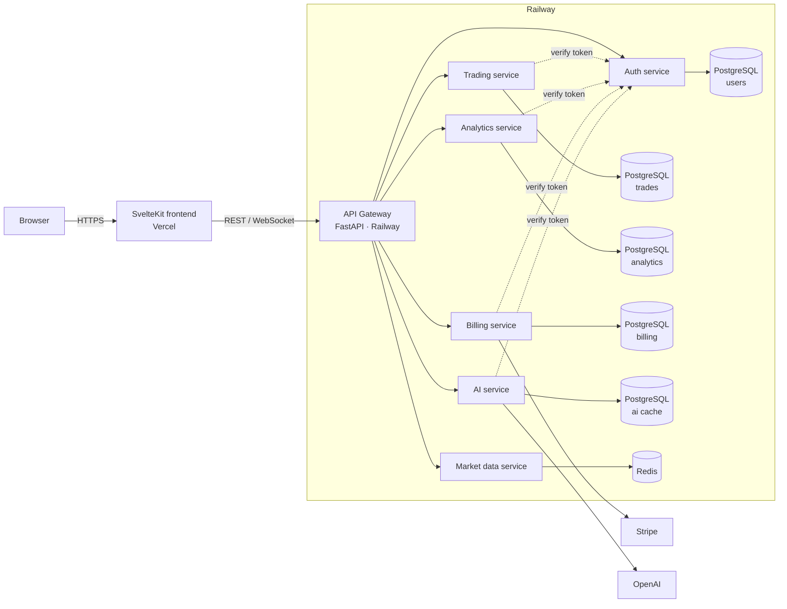

# TradeSense

**Trading analytics and journaling platform for active traders.**

TradeSense lets traders import or log their trades, review performance with analytics dashboards, keep a structured trading journal, and get AI-assisted insights on their behaviour and risk. Each user's data is private to their account, and premium features are unlocked through Stripe subscriptions.

---

## Key features

| Area | What it does |
|---|---|
| Trade log & import | Record trades manually or bulk-import broker CSV exports; tag, search and filter |
| Analytics | P&L, win rate, drawdown and per-strategy performance dashboards; custom dashboard builder |
| Journal & playbooks | Notes, reflections and playbooks linked to trades |
| Portfolio | Positions and portfolio-level views |
| AI insights | Pattern detection and trade critique (OpenAI-backed AI service) |
| Market data | Quote lookup with Redis caching |
| Billing | Stripe subscription tiers (Basic / Pro / Premium) |
| Authentication | JWT auth via httpOnly cookie (browser) or Bearer token (API clients); optional MFA |
| Per-user data isolation | Every user-owned query is scoped to the authenticated user ID taken from the token |

## Architecture



Production runs as independently deployable FastAPI services behind a single gateway. For local development there is also a consolidated FastAPI application in `src/backend/` that serves the full API from one process. Details: [docs/architecture.md](docs/architecture.md).

## Tech stack

| Layer | Technology |
|---|---|
| Frontend | SvelteKit 2, Svelte 4, TypeScript, Vite 5, Chart.js, Vitest, Playwright |
| Backend | Python 3.11, FastAPI, SQLAlchemy 2, Alembic, Pydantic |
| Auth | JWT (HS256), bcrypt password hashing, httpOnly cookies, optional MFA |
| Data | PostgreSQL 15, Redis 7 |
| Integrations | Stripe (billing), OpenAI (AI insights) |
| Hosting | Vercel (frontend), Railway (services + managed Postgres/Redis) |
| CI/CD | GitHub Actions: tests, Gitleaks, CodeQL, Railway + Vercel deploy |

## Repository layout

```
frontend/         SvelteKit web app (deployed to Vercel)
services/         Production microservices: gateway, auth, trading, analytics,
                  market-data, billing, ai — each with its own Dockerfile + railway.toml
src/backend/      Consolidated FastAPI backend used for local development
tests/            Backend test suites
docs/             Documentation (start with the links below)
infra/, k8s/, terraform/, monitoring/   Infrastructure and observability configs
```

## Run locally

**Prerequisites:** Docker + Docker Compose, or Python 3.11 and Node.js 18+.

### Option A — Docker (one command)

```bash
git clone https://github.com/tarigelamin1997/tradesense.git
cd tradesense
docker compose -f docker-compose.simple.yml up
```

| Service | URL |
|---|---|
| Frontend | http://localhost:5173 |
| API | http://localhost:8000 |
| API docs (Swagger) | http://localhost:8000/docs |
| PostgreSQL | localhost:5433 |
| Redis | localhost:6379 |

The compose file uses throwaway local credentials only. Never reuse them anywhere else.

### Option B — run backend and frontend directly

```bash
# 1. Databases only
docker compose -f docker-compose.db-only.yml up -d

# 2. Backend
python -m venv .venv && source .venv/bin/activate
pip install -r requirements.txt
cp .env.example .env            # fill in values — see docs/configuration.md
cd src/backend && uvicorn main:app --reload --port 8000

# 3. Frontend (new terminal)
cd frontend
npm install
npm run dev                     # http://localhost:3001
```

### Option C — microservices topology

```bash
docker compose -f docker-compose.microservices.yml up   # gateway on :8000 (gateway + auth + trading)
```

### Tests

```bash
pytest tests/                   # backend
cd frontend && npm test         # frontend unit tests
cd frontend && npm run test:e2e # Playwright end-to-end
```

## Documentation

| Doc | Contents |
|---|---|
| [Architecture](docs/architecture.md) | Services, data ownership, request flow, design decisions |
| [Deployment](docs/deployment.md) | Railway (services) + Vercel (frontend), step by step |
| [Configuration](docs/configuration.md) | Every environment variable, by service — names and purpose only |
| [Security](docs/security.md) | Authentication design, per-user data isolation, secret handling |
| [API reference](docs/api-reference.md) | REST endpoints |
| [Documentation index](docs/README.md) | Full documentation tree |

## License

See [LICENSE](LICENSE).
