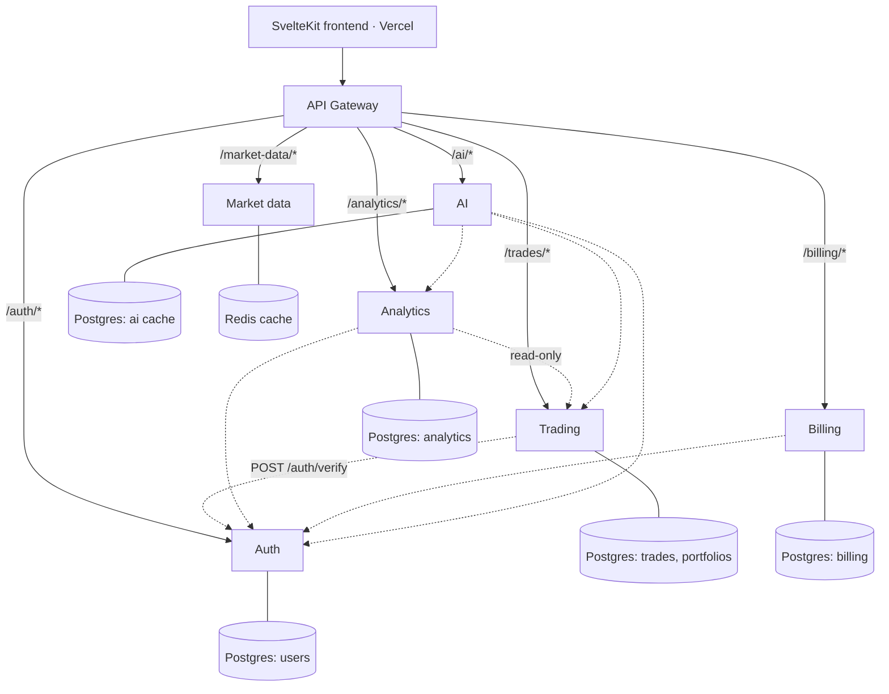
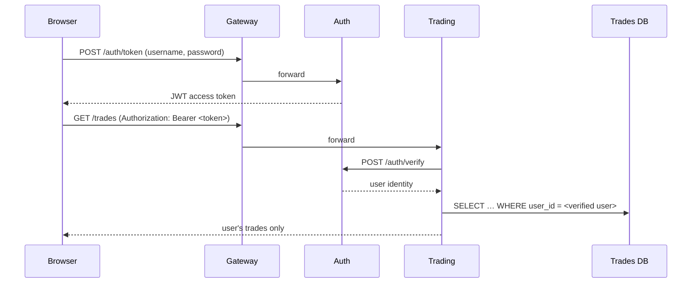

# Architecture

TradeSense is a SvelteKit frontend backed by a set of FastAPI services. In production each service is deployed independently on Railway behind a single API gateway; for local development the same API surface is also available as one consolidated FastAPI application.

## System overview

## Services

All services live under `services/<name>/`, each with its own `Dockerfile`, `railway.toml`, `requirements.txt` and a `/health` endpoint.

| Service | Responsibility | Owns | Calls |
|---|---|---|---|
| **gateway** | Single public entry point: routing, CORS, health aggregation (`/health`, `/services`), metrics (`/metrics`) | — | all services |
| **auth** | Registration, login (`/auth/token`), current user (`/auth/me`), token verification for other services (`/auth/verify`) | users | — |
| **trading** | Trades (`/trades`), portfolio and portfolio value (`/portfolio`) | trades, portfolios | auth |
| **analytics** | Performance, patterns and summary metrics (`/analytics/*`) | analytics data | auth, trading (read-only) |
| **market-data** | Quotes, historical data and summaries with caching (`/market-data/*`) | Redis cache | external market APIs |
| **billing** | Stripe checkout, subscription status/cancel, webhooks, plans (`/billing/*`) | billing records | auth, Stripe |
| **ai** | Market analysis, trade suggestions, free-form queries, insights (`/ai/*`) | AI response cache | auth, trading, analytics, OpenAI |

### Gateway routing

The gateway proxies by path prefix (`/auth/*`, `/trades/*`, `/analytics/*`, `/market-data/*`, `/billing/*`, `/ai/*`, plus a generic `/api/*` route). Downstream service addresses come from `*_SERVICE_URL` environment variables, so the same image works locally (`localhost` ports) and on Railway (public or private-network URLs). See [configuration.md](configuration.md).

### Consolidated backend (`src/backend/`)

`src/backend/` is a single FastAPI application exposing the full versioned API under `/api/v1/*` (auth, trades, analytics, journal, playbooks, portfolio, billing, AI, websocket, admin, and more). It is the fastest way to run the whole product locally (`docker-compose.simple.yml`) and is where most domain logic, Alembic migrations and the test suite live. The microservices were extracted from it.

## Request flow

## Data ownership

- **Database per service.** Each stateful service owns its schema; no service reads another service's tables directly. Cross-service data goes over HTTP.
- **User identity is the partition key.** Every user-owned table carries `user_id`, and every query on it filters by the identity resolved from the token. See [security.md](security.md).
- **Redis** is a cache for market data, not a system of record.

## Frontend

- SvelteKit 2 with `@sveltejs/adapter-vercel`, deployed from the `frontend/` directory.
- API base URL is configured via `PUBLIC_API_URL` / `VITE_API_BASE_URL`; `VITE_USE_GATEWAY` switches between gateway routing (default) and direct service URLs.
- Unit tests with Vitest, end-to-end tests with Playwright.

## Design decisions

| Decision | Chosen | Rejected | Why |
|---|---|---|---|
| Service topology | Gateway + per-domain services | Single deployed monolith | Fault isolation (billing or AI failures don't take down trade logging), independent deploys and scaling per service |
| Service-to-service auth | Central token verification via auth service | Each service decoding JWTs with a shared secret | One place owns token semantics and revocation; fewer services holding the signing key |
| Database layout | Database per service | Shared database | Clear ownership boundaries; schema changes don't ripple across services |
| Local development | Consolidated `src/backend` app | Running 7 services + 5 databases locally | Fast feedback loop; full API in one process |
| Hosting | Railway (API) + Vercel (frontend) | Self-managed Kubernetes | Managed TLS, Postgres and deploys at small-team cost. `k8s/` and `terraform/` hold configs for a future move |

## Roadmap

- Move inter-service traffic to Railway private networking (`*.railway.internal`).
- Redis pub/sub for asynchronous events between services.
- Background job queue (Celery) for imports and report generation.
- Centralised structured logging and tracing across services.
