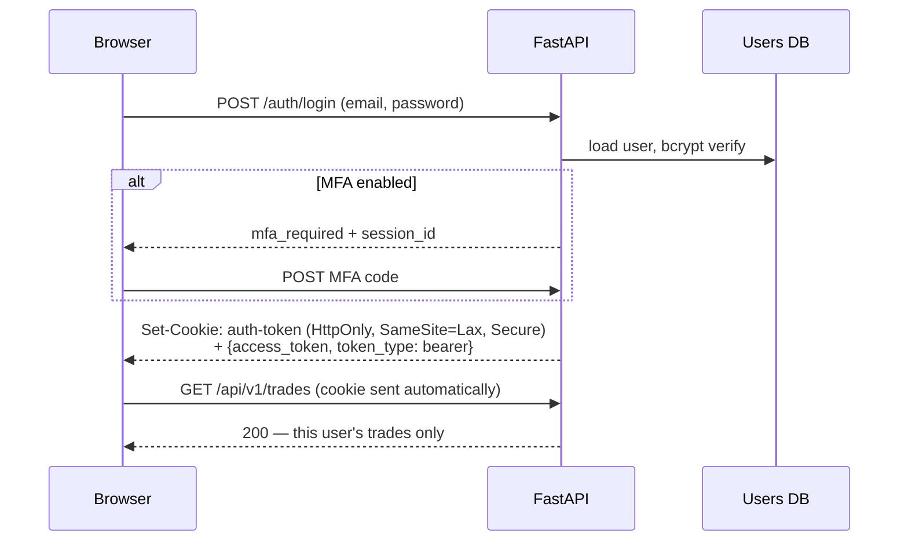

# Security

This page describes how TradeSense authenticates users, isolates each user's data, and handles secrets.

## Authentication

TradeSense uses stateless **JWT access tokens** issued by FastAPI.

| Property | Value |
|---|---|
| Algorithm | HS256 (HMAC-SHA256) |
| Signing key | `JWT_SECRET_KEY` (environment only — see [configuration.md](configuration.md)) |
| Subject (`sub`) | The user's identifier |
| Lifetime | 30 minutes by default (`JWT_ACCESS_TOKEN_EXPIRE_MINUTES`) |
| Password storage | bcrypt via `passlib` — plaintext passwords are never stored or logged |

### Two ways to present the token

> **Scope:** the cookie + Bearer dual transport below is implemented in the consolidated backend (`src/backend`). The production auth microservice (`services/auth`) currently issues **Bearer tokens only** via `POST /auth/token`; it does not set a cookie. Bringing the cookie flow to the microservice is on the roadmap.

The consolidated API accepts the same token from two transports so that browsers and programmatic clients are both first-class:

| Client | Transport | How it works |
|---|---|---|
| Browser (SvelteKit app) | **httpOnly cookie** `auth-token` | Set by the login response. `HttpOnly` (not readable by JavaScript, which blunts XSS token theft), `SameSite=Lax` (not sent on cross-site sub-requests, mitigating CSRF), `Secure` when `ENVIRONMENT=production`, `Path=/`, `Max-Age` = token lifetime |
| API clients, mobile, scripts | **Bearer header** `Authorization: Bearer <token>` | Token returned in the login response body |

Resolution order in the `get_current_user` dependency (`src/backend/api/deps.py`):

```text
1. auth-token cookie present?        → use it
2. else Authorization: Bearer?       → use it
3. else                              → 401 Not authenticated
4. decode + verify signature/expiry  → 401 on failure
5. load user by id from `sub`        → 401 if missing or inactive
6. return User → injected into the route handler
```

Logout clears the cookie with the same attributes it was set with.

### Login flow



### Microservices

In the distributed deployment the **auth service is the only token authority**. Other services never trust a caller-supplied user ID: they extract the Bearer token, call `POST /auth/verify` on the auth service with the token in the `Authorization` header (never in the URL, so it can't leak into access logs), and use the identity it returns. This keeps signing-key exposure to the auth service and gives one place to change token rules.

| Outcome | Status returned to the client |
|---|---|
| Missing or malformed `Authorization` header | `401` |
| Token rejected by the auth service | `401` |
| Auth service unreachable or erroring | `503` |

If `JWT_SECRET_KEY` is not set, the auth service generates a random per-process key and logs a critical error. It never falls back to a fixed default string, so a missing variable can log users out but cannot make tokens forgeable.

### Multi-factor authentication

The consolidated backend supports optional MFA. When enabled for an account, password login returns an MFA challenge instead of a token; the token is issued only after the second factor is verified. SMS delivery uses Twilio.

## Per-user data isolation

Every user-owned record (trades, portfolios, journal entries, playbooks, analytics, billing) carries a `user_id`. Isolation is enforced on the server:

1. **Identity comes only from the verified token.** Handlers receive the user via `Depends(get_current_user)`; a `user_id` in a request body or query string is never used to select whose data to read.
2. **Every query on user data is filtered by that identity**, for example:

   ```python
   db.query(Trade).filter(Trade.user_id == current_user.id)
   ```

3. **Writes stamp ownership server-side** — new records get `user_id` from the authenticated user, not from client input.
4. **Lookups by ID include the owner filter** — e.g. `and_(Trade.id == trade_id, Trade.user_id == user_id)` — so another user's record ID resolves to "not found", never to the record.
5. **Admin endpoints** require `role == "admin"` via a separate `get_admin_user` dependency.

## Payment webhooks

`POST /billing/webhook` accepts only events signed by Stripe. The `Stripe-Signature` header is verified against `STRIPE_WEBHOOK_SECRET` with `stripe.Webhook.construct_event`; unsigned or tampered requests get `400`, and if the secret is not configured every webhook is rejected with `503` rather than processed unverified.

## Transport and browser protections

- HTTPS everywhere in production (Vercel and Railway terminate TLS).
- CORS allow-list from `CORS_ORIGINS` / `CORS_ORIGINS_STR`; only listed frontend origins may make credentialed requests.
- Security headers on the frontend (`X-Content-Type-Options: nosniff`, `X-Frame-Options: DENY`) via `frontend/vercel.json`.

## Secret management

- Secrets live only in Railway / Vercel environment settings and GitHub Actions secrets.
- `.env.example` documents variable names with empty values; real `.env` files must stay untracked.
- CI runs **Gitleaks** and **Trivy** on every push and pull request (`.github/workflows/railway-deploy.yml`, `security-scan.yml`), plus **CodeQL** static analysis.
- A pre-commit setup (`setup-secret-scanning.sh`) adds local secret detection before commits.
- Any secret that is ever committed is treated as compromised and rotated; deleting it in a later commit does not remove it from git history.

## Reporting a vulnerability

Please report security issues privately to the repository owner via GitHub rather than opening a public issue.
